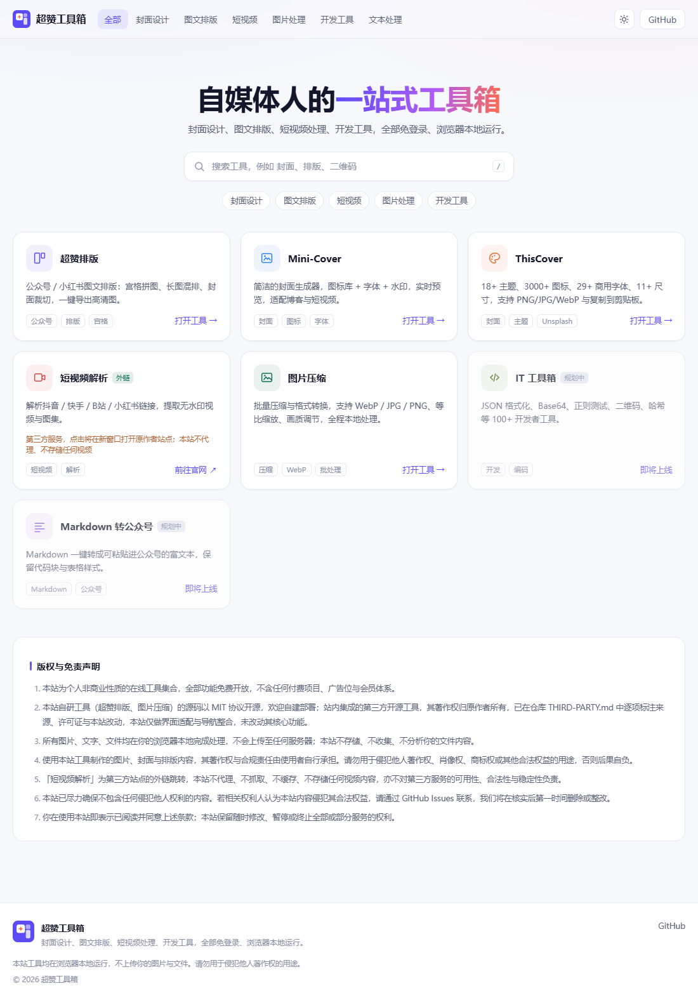
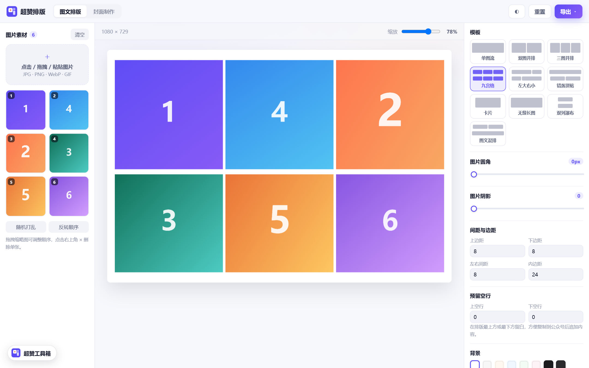
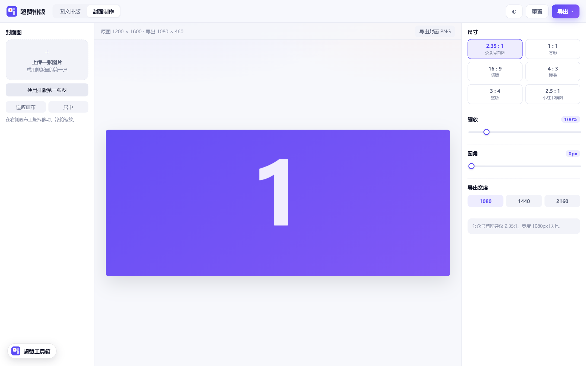
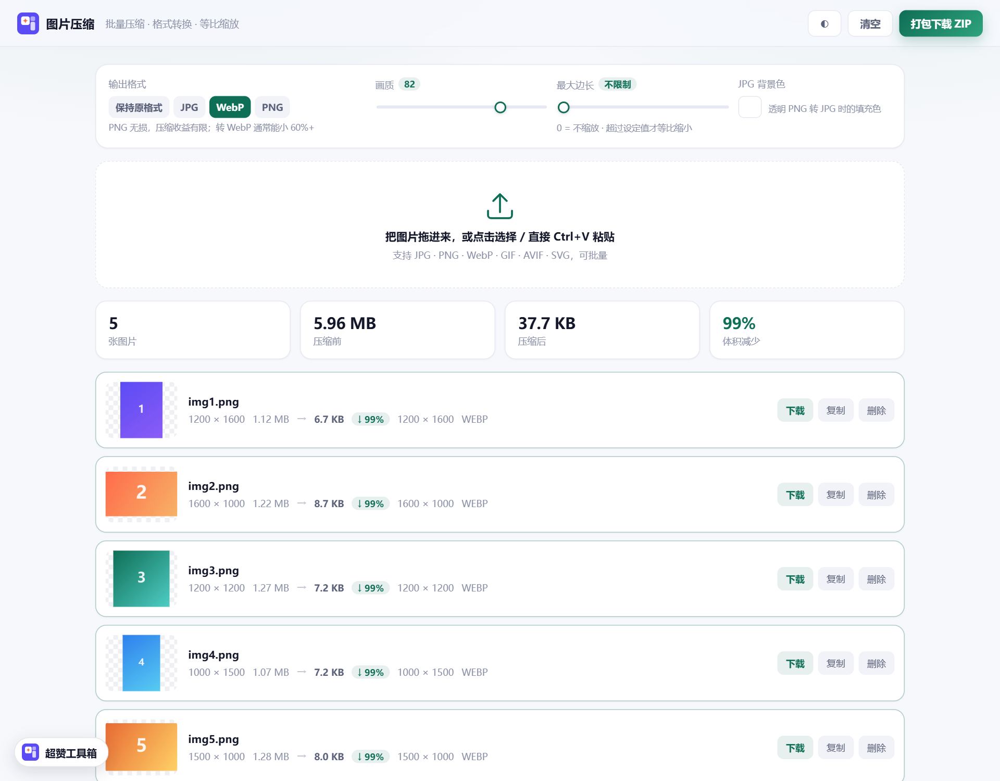
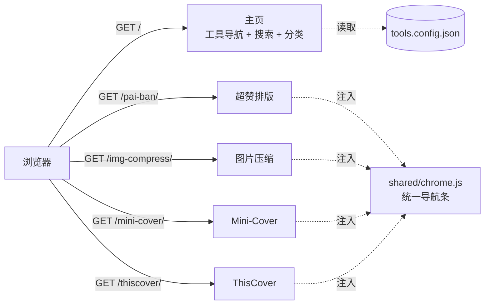

<div align="center">


# 超赞工具箱

**自媒体人的一站式在线工具集 —— 一个静态站点，装下所有工具**

封面设计 · 图文排版 · 图片处理 · 文档处理 · 短视频

免登录 · 无后端 · 不上传文件 · 纯静态部署

[](LICENSE)
[](#-技术选型)
[](#-隐私)
[](https://edgeone.ai/products/pages)
[](CONTRIBUTING.md)

[在线体验](https://chaozan-toolbox-djfyzhlc.edgeone.cool/) · [功能一览](#-功能一览) · [架构](#-架构) · [快速开始](#-快速开始) · [新增工具](#-新增一个工具) · [合规说明](#-合规与授权)

<sub>演示站部署在 EdgeOne Makers，预览域名默认带访问保护（首次访问需带 token）。绑定已备案的自定义域名后即为公开站点。</sub>

</div>



---

## 这是什么

自媒体人日常要用的工具，往往散落在十几个网站上：排版去一个站、做封面去另一个站、压图片再换一个站，每个都要注册、要登录、要充值，图片还得先上传到别人的服务器。

**超赞工具箱把这类工具收进了一个域名、一个静态站点里。**

访问 `yoursite.com/pai-ban/` 就是排版工具，`yoursite.com/mini-cover/` 就是封面工具，`yoursite.com/img-compress/` 就是图片压缩。**不是子域名、不是 iframe 套壳、不是每个工具一个 Worker**，而是同一个项目下的不同目录，共享一套导航、一套视觉、一份构建脚本。

- **免登录**：打开即用，没有账号体系，没有次数限制。
- **无后端**：所有图片的解码、缩放、重编码都在浏览器里完成，不上传、不落盘、不分析。
- **零成本**：纯静态产物，可白嫖 EdgeOne Pages / GitHub Pages / Vercel 的免费额度。
- **好扩展**：加一个工具只需改一份 JSON + 丢一个目录，主页卡片、搜索、分类、导航条全自动。

## 与上游项目的关系

说清楚这件事，比藏起来更安全，也更体面：

| 部分 | 来源 | 说明 |
| --- | --- | --- |
| 主页、构建脚本、统一导航、`tools.config.json` 架构 | **本项目原创** | MIT |
| 超赞排版 `/pai-ban/` | **代码自研**，界面与模板参照 [麻雀排版](https://maque.toai.art/) | 原生 JS 重写，模板数据来自其公开接口的免费模板，见 [`NOTICE`](NOTICE) 第 4 条 |
| 图片压缩 `/img-compress/` | **本项目原创** | 手写 ZIP 编码器，无第三方依赖 |
| 超赞水印 `/watermark/` | **本项目原创**，功能参照 [xyh9949/image-watermark](https://github.com/xyh9949/image-watermark) · MIT | Canvas 2D 手写实现，未复制上游源码 |
| 超赞图片工坊 `/squoosh/` | [GoogleChromeLabs/squoosh](https://github.com/GoogleChromeLabs/squoosh)（dashancn fork） · Apache-2.0 | 仅构建压缩器主应用，品牌与主题替换 |
| 超赞证件照 `/passport-photo/` | [dashancn/passport-photo-studio](https://github.com/dashancn/passport-photo-studio) · **AGPL-3.0** | 品牌替换 + 移除生态导航，功能逻辑未改 |
| 超赞PDF `/pdf/` | [PDFCraftTool/pdfcraft](https://github.com/PDFCraftTool/pdfcraft) · **AGPL-3.0** | 静态导出适配（`BASE_PATH=/pdf`）+ 品牌替换 + 移除原作者外链 |
| Mini-Cover `/mini-cover/` | [JLinMr/Mini-Cover](https://github.com/JLinMr/Mini-Cover) · MIT · © 2025 摸鱼玩家 | 界面适配 + 品牌替换，功能逻辑未改 |
| ThisCover `/thiscover/` | [weizwz/cover](https://github.com/weizwz/cover) · MIT · © 2025 weizwz | 静态导出适配 + 界面适配 + 品牌替换 |
| 短视频解析 | [jiuhunwl/shortvideo-html](https://github.com/jiuhunwl/shortvideo-html) · MIT · © BugPk | **仅外链**，不分发其代码 |

**本项目做的是「整合」而不是「重写」**：把几个各自独立的开源工具，改造成能在同一个域名下共存、视觉统一、导航一致的站点。这部分工程（单项目多目录路由、构建期注入、子目录路径改写、Next 静态导出的 RSC 预取补丁）是原创的；封面渲染、图标库这些能力来自上游，著作权归原作者。

MIT 许可允许修改、改名、商用甚至闭源，前提是**保留版权声明与许可全文**，并且**不声称上游代码是自己原创**。本项目按此执行：

- [`NOTICE`](NOTICE) —— 逐项列出上游项目、版权人、引入方式、本站改动
- [`THIRD-PARTY-LICENSES/`](THIRD-PARTY-LICENSES) —— 各项目许可证原文
- 构建时自动复制到 `dist/licenses/`，随站点一起分发（访问 `/licenses/NOTICE.txt` 可见）
- 主页底部《版权与免责声明》与「开源许可」入口同样写明这层关系

> 想基于本项目做自己的工具站，完全可以 —— 但请保留 `NOTICE` 与 `THIRD-PARTY-LICENSES/`，别把上游署名删干净。**删署名比改代码更容易惹麻烦。**

## 功能一览

### 🎨 超赞排版 `/pai-ban/` · 代码自研 · 界面复刻

公众号图文排版助手。三栏布局：左边放图、中间手机实时预览、右边调参数，调完直接复制进公众号编辑器。

<table>
<tr>
<td width="50%"></td>
<td width="50%"></td>
</tr>
<tr>
<td align="center"><b>三栏排版</b>：33 套模板 + 12 组参数卡片</td>
<td align="center"><b>封面制作</b>：跳转 Mini-Cover 生成首图</td>
</tr>
</table>

**核心差异：预览区是真实 DOM，不是 Canvas。** 模板本身就是一段带内联样式的 `section` 嵌套结构，图片位用 `data-maque` 标记。所以「预览长什么样，粘进公众号就长什么样」——不存在两套渲染管线对不上的问题。

- **33 套免费模板**：单图填满、双图并排、三图并排、九宫格、左大右小、错落拼贴、PC 壁纸、带序号、带文案位等；按「单图 / 双图 / 三图 / 四图 / 5 图以上」分类
- **图片数量自适应**：图片比模板位数多 → 模板整组重复拼接；少 → 空位自动隐藏，剩下的图撑满整行
- **积木块编辑**：点预览里任意一行出现绿框 + `↑ ↓ ×` 浮动条，整块上移 / 下移 / 删除
- **参数卡片**（右栏 12 组，与原站一一对应）：防盗图、封面制作、图片圆角（全部 + 四角）、图片阴影（上下 / 左右 / 模糊 / 颜色）、行间隔（上 / 下 `0–200`）、预留空行（上 / 下）、设置背景（图片 / 纯色 / 圆角）、排版缩放（内边距 `0–60`）、智能广告、文章复制
- **文案**：位置（最上面 / 最下面 / 图文穿插）、字号、行高、字间距、颜色、对齐、粗细；穿插模式按空行分组自动插到每行图片之后
- **导出**：复制富文本（图片转 base64、样式全内联，直接粘进公众号）／ 导出长图（2 倍图，SVG `foreignObject` → Canvas，零依赖）
- **防盗图**：开启后 `` 换成同比例的 `background-image` 容器，读者长按拿不到原图，复制后依然生效
- **智能广告**：开启后在每行图片前后插入 `display:none` 的隐藏文字（读者不可见，公众号搜索能抓到），文字内容与字数可自定义，实时显示「当前字数 / 覆盖行数」
- **排版提取**：把别人文章的正文粘进来，直接变成可编辑的排版
- **预设**：参数存 localStorage，下次打开自动恢复
- **全部本地处理**：图片不进服务器，关掉页面即清除

> **为什么能做到「粘过去不走样」**：公众号编辑器只认内联样式，所以复制时会把整棵 DOM 清洗成纯 `style=""`，图片转成 base64，外层的 `padding` 也保留下来——不会被自己的 `padding:0` 覆盖掉。

#### 与原站的关系

界面结构、参数体系与模板排版数据参照 [麻雀排版](https://maque.toai.art/) 的公开页面与公开接口复刻，**代码全部用原生 JS 重写**（原站是 uni-app + Vue 2 + TinyMCE，本站零框架、零第三方依赖，整包 178 KB）。只收录其免费模板，不含任何 PRO 内容。详见 [`NOTICE`](NOTICE) 第 4 条。

**智能广告已实现**（纯前端即可，不依赖任何接口）：开启后在每行图片前后各插入 8 段 `display:none` 的隐藏文字，跳过第 1 行、最多 20 行；文字从你输入的内容里循环截取，每侧首段 100–150 字、其余 10–20 字，留空则用 300 个点填充。读者看不见，但公众号会把这些文字纳入搜索索引。算法与原站一致。

只剩两项依赖公众号 OAuth 的功能（绑定公众号、同步导出到草稿箱）在纯前端环境下无法实现，本站保留入口并给出明确提示，不做假成功。

### 🗜 图片压缩 `/img-compress/` · 自研



- 批量拖拽 / 选择 / `Ctrl+V` 粘贴，支持 JPG · PNG · WebP · GIF · AVIF · SVG
- 输出 WebP / JPG / PNG，或保持原格式；画质、最大边长可调
- 透明 PNG 转 JPG 可指定背景色，不会糊成黑底
- 逐张对比「压缩前 → 压缩后」体积与尺寸，体积减少百分比一目了然
- 一键打包 ZIP 下载 —— **ZIP 编码器是手写的**（CRC32 + 本地文件头 + 中央目录 + EOCD，store 模式），没引任何第三方库

### 🖼 封面生成（集成第三方）

| 工具 | 路径 | 说明 |
| --- | --- | --- |
| **Mini-Cover** | `/mini-cover/` | 图标库 + 字体 + 水印，实时预览，适配博客与短视频封面 |
| **ThisCover** | `/thiscover/` | 18+ 主题、3000+ 图标、29+ 商用字体、11+ 尺寸，支持 PNG / JPG / WebP |

两个工具都是 MIT 开源项目，本站做了**界面适配、品牌替换与导航整合**，未改动其核心渲染与导出逻辑。示例封面图是本站用工具自身渲染后保存到本地的（原作者的图床开了防盗链，站外引用一律 403），因此不再依赖任何第三方图床。

### 🔗 短视频解析（外链）

第三方服务，点击在新窗口打开原作者站点。**本站不代理、不抓取、不缓存、不存储任何视频内容**，也不对其可用性与合法性负责。

## 架构

### 一个项目，多个子目录



### 构建产物

```
dist/
├── index.html            # 主页
├── tools.config.json     # 工具清单（运行时也读它）
├── assets/               # LOGO、公共图片
├── shared/chrome.js      # 统一导航条（Shadow DOM）
├── pai-ban/              # → /pai-ban/
├── img-compress/         # → /img-compress/
├── mini-cover/           # → /mini-cover/
└── thiscover/            # → /thiscover/
```

没有反向代理、没有跨域、没有多项目绑定。**一个 `dist/` 传上去就完事**，新增工具也不会多出任何域名或项目。

### 返回首页是怎么做的

每个工具页的**左上角**都有一个返回入口，**点一次**就回到主页 —— 不需要先展开菜单再点「返回首页」。

- **自研工具**（超赞排版 / 图片压缩）：返回按钮直接做进它们自己的顶栏，跟界面浑然一体
- **Mini-Cover**：工具本身顶栏左侧是空的，注入一枚浮动胶囊 `← 返回首页`，旁边 `⋯` 展开博客 / 社交 / 更多工具
- **ThisCover**：改写它的顶栏组件，把返回入口放在 logo 左边

浮动胶囊由 `shared/chrome.js` 提供，用 `attachShadow({ mode: 'open' })` 挂载 —— **Shadow DOM 的样式与宿主页面完全隔离**，既不污染工具自身 CSS，也不会被工具的主题色影响。

工具自己顶栏已经有返回入口时，在 `tools.config.json` 里写 `"chrome": false` 关掉注入即可，避免两个返回按钮叠在一起。

## 技术选型

| 决策 | 选择 | 原因 |
| --- | --- | --- |
| 部署形态 | 单静态站点 + 子目录 | 一个项目、一个域名、一份证书，无跨域，无多项目额度消耗 |
| 主页 | 原生 JS + CSS 变量 | 只有一个列表页，引框架属于给自己加构建负担 |
| 配置 | `tools.config.json` 单一数据源 | 主页渲染、搜索、分类、构建脚本读同一份数据，不会不一致 |
| 排版渲染 | Canvas 2D 单一管线 | 预览与导出共用一套布局代码，杜绝「所见非所得」 |
| 导航 | 顶栏原生按钮 + Shadow DOM 浮动胶囊 | 自研工具用原生按钮更自然，第三方工具用 Shadow DOM 与宿主样式双向隔离 |
| 第三方集成 | 构建期复制产物 | 不改其源码，升级只需重新构建 |
| 后端 | **没有** | 所有处理在浏览器完成，天然免登录、零服务器成本、零数据风险 |

## 快速开始

```bash
# 1. 克隆
git clone https://github.com/mkmkgo/chaozan-toolbox.git
cd chaozan-toolbox

# 2. 构建 + 本地预览（自研工具可直接跑起来）
npm run build      # 汇总构建到 dist/
npm run dev        # 构建后启动 http://127.0.0.1:8899
```

> 环境要求：Node.js >= 18。项目本身**零运行时依赖**，`package.json` 里没有 `dependencies`。

要跑完整的第三方工具（Mini-Cover / ThisCover），还需要各自装依赖并构建。**它们的源码已在 `vendor/` 里，并且已经改好**（品牌替换、静态导出配置），不需要再拉取：

```bash
# Mini-Cover（Vue3 + Vite）
cd vendor/Mini-Cover-main && npm install && npx vite build --base=./ && cd ../..

# ThisCover（Next.js 16 静态导出）
cd vendor/cover-main && npm install --legacy-peer-deps && npx next build && cd ../..

npm run build                        # 再次构建，第三方产物一起进 dist/
```

> `--base=./` 用相对路径，工具在 `/mini-cover/` 子目录下才能正确加载资源。
> `--legacy-peer-deps` 是 ThisCover 的 `react-day-picker@8` 与 `date-fns@4` 的 peer 冲突导致的，不是本项目的问题。

## 新增一个工具

### 情况 A：自己写的静态工具

1. 把文件丢进 `tools/<slug>/`（含 `index.html`）
2. 在 `tools.config.json` 的 `tools` 数组里加一条：

```json
{
  "slug": "my-tool",
  "name": "我的工具",
  "desc": "一句话说清它解决什么问题",
  "category": "dev",
  "icon": "code",
  "color": "#3B6D11",
  "tags": ["标签1", "标签2"],
  "status": "ready",
  "license": "自研",
  "buildDir": "tools/my-tool"
}
```

3. `npm run build` —— 产物自动进 `dist/my-tool/`，导航条自动注入，主页卡片自动出现

### 情况 B：集成第三方开源项目

1. 源码放 `vendor/<名字>/`，跑它自己的构建命令拿到静态产物
2. 同上登记，`buildDir` 指向产物目录（如 `vendor/xxx/dist`）
3. 构建脚本会自动处理两件容易踩坑的事：
   - **改写根路径**：第三方项目常把资源写成 `/logo.png`，放进子目录就会 404，构建时会扫描 HTML / JS / RSC payload 统一改写成 `/my-tool/logo.png`
   - **注入导航条**：递归遍历所有 HTML（含子路由，如 `/thiscover/editor/`），一个不漏

### 字段说明

| 字段 | 必填 | 说明 |
| --- | --- | --- |
| `slug` | ✅ | URL 路径，`pai-ban` → `/pai-ban/` |
| `status` | ✅ | `ready` 本站内运行 / `external` 外链跳转 / `planned` 占位未上线 |
| `buildDir` | `ready` 必填 | 产物目录，相对仓库根 |
| `url` | `external` 必填 | 外链地址 |
| `basePath` | ❌ | 工具内部写死的根路径前缀，默认 `/<slug>` |
| `chrome` | ❌ | 设为 `false` 表示该工具自带返回入口，不再注入浮动导航 |
| `note` | ❌ | 卡片上的补充说明（外链工具会显示） |

## 部署

### EdgeOne Pages（推荐，国内访问快）

1. 控制台 → **EdgeOne Pages** → 创建项目
2. 构建命令填 `npm run build`，输出目录填 `dist`（或本地构建好后直接拖 `dist/` 上传）
3. 绑定自定义域名需要该域名**已完成 ICP 备案** —— 国内站这是硬性要求，绕不过去

### 其他静态托管

产物是纯静态文件，扔哪都能跑：

```bash
# Vercel
vercel deploy dist --prod

# GitHub Pages / Netlify / Cloudflare Pages / 对象存储 / Nginx
# 直接把 dist/ 当站点根目录即可
```

唯一要求：**必须支持目录 → `index.html`**（所有主流静态托管都支持）。

### 命令行部署（EdgeOne Makers）

```bash
npm i -g edgeone
edgeone makers deploy dist -n your-project-name
```

> 注意：`builtFolderPath` 参数会被 CLI 忽略，必须把目录作为位置参数传入。

## 隐私

- 图片、文字、文件**全部在浏览器本地处理**，没有任何上传接口。
- 项目里没有埋点、没有统计脚本、没有第三方分析。
- 唯一的外部请求是 ThisCover 的 Unsplash 图库（需要你自己配 API Key），以及「短视频解析」的外链跳转。

## 合规与授权

做工具站最容易踩的三类坑，这个项目都主动绕开了：

| 风险 | 处理方式 |
| --- | --- |
| **冒用他人备案号 / 版权信息** | 集成第三方项目时清空了原作者写死的 ICP 备案号，避免被误认为本站备案 |
| **盗用第三方图床** | 清空了第三方项目里指向原作者图床的上传地址，不占用他人带宽 |
| **视频解析类侵权** | 不内置去水印解析，只做外链跳转到原作者站点；不代理、不抓取、不缓存、不存储 |
| **抓取他人文章内容** | 不做「文章排版提取」，只处理用户自己上传的图片 |
| **可能违反平台规则的功能** | 「智能广告」按原站逻辑实现（隐藏文字），卡片内保留原站的风险提示，用不用由使用者决定 |

- **本项目原创代码**：[MIT](LICENSE)，欢迎 fork、自建、二次开发。
- **第三方工具**：均为 MIT，保留原版权声明，逐项来源与改动明细见 [THIRD-PARTY.md](THIRD-PARTY.md)。
- **主页内置《版权与免责声明》**，文案在 `tools.config.json` 的 `site.legal.items` 里，可按需改写。
- **自建部署前请替换**：`site.blog` / `site.repo` / `site.social` / `footer.icp` / `footer.police`，别沿用占位值。

## 已知限制

- 公众号「同步到草稿箱」需要公众号 OAuth 授权 + 服务端中转，与「免登录 + 无后端」直接冲突，因此只做本地排版与导出。
- 「复制富文本」走 base64 内嵌图片，粘贴进公众号编辑器后若图片丢失，请改用「导出长图」再插入（公众号对 base64 的处理策略会变）。
- 浏览器 Canvas 不保留 GIF 动画，GIF 进排版会被当作静态图；压缩工具也不处理 GIF 动效。
- 导出长图超过 16384px 时会自动降低倍率（浏览器画布尺寸上限）。
- 第三方工具升级后可能改变构建方式，重新构建时请对照其 README。

## Roadmap

- [x] 单项目多工具架构 + 统一导航
- [x] 超赞排版（图文排版 + 封面制作）
- [x] 图片压缩与格式转换
- [x] 集成 Mini-Cover / ThisCover
- [ ] Markdown 转公众号富文本
- [ ] IT 工具箱（JSON / Base64 / 正则 / 二维码 / 哈希）
- [ ] 排版模板支持自定义保存与分享
- [ ] 深色模式跟随系统

## 参与贡献

欢迎 Issue 与 PR。提 PR 前请先看一眼 [CONTRIBUTING.md](CONTRIBUTING.md) —— 主要是三件事：新增工具走配置驱动、不要引入运行时依赖、不要破坏第三方工具的原有功能。

## 致谢

本站的封面生成能力来自这些优秀的开源项目，感谢作者的无私分享：

- [JLinMr/Mini-Cover](https://github.com/JLinMr/Mini-Cover) —— 简洁的封面生成器 · © 2025 摸鱼玩家
- [weizwz/cover](https://github.com/weizwz/cover) —— ThisCover · © 2025 weizwz
- [jiuhunwl/shortvideo-html](https://github.com/jiuhunwl/shortvideo-html) —— 短视频解析 · © BugPk & JH-Ahua

## License

[MIT](LICENSE) © 2026 chaozan

- **本项目原创代码**（主页、构建脚本、统一导航、超赞排版、超赞水印、图片压缩）：MIT，随便用。
- **集成的第三方工具**：仍归其原作者所有，MIT 许可，许可证原文见 [`THIRD-PARTY-LICENSES/`](THIRD-PARTY-LICENSES)，来源与改动明细见 [`NOTICE`](NOTICE) 与 [`THIRD-PARTY.md`](THIRD-PARTY.md)。
- **再分发 `dist/`**：请连同 `dist/licenses/` 一起分发 —— 这是 MIT 的硬性要求，不是可选项。
