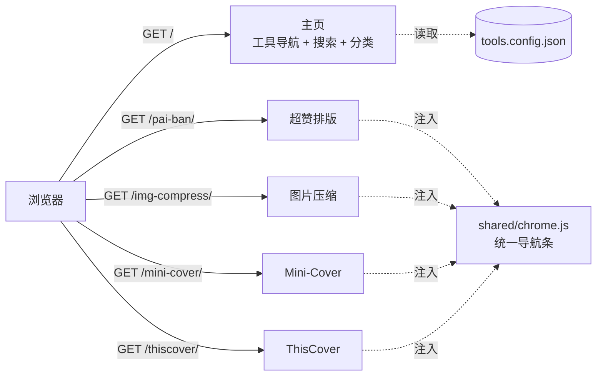

<div align="center">


# 超赞工具箱

**自媒体人的一站式在线工具集 —— 一个静态站点，装下所有工具**

封面设计 · 图文排版 · 图片压缩 · 短视频处理

免登录 · 无后端 · 不上传文件 · 纯静态部署

[](LICENSE)
[](#-技术选型)
[](#-隐私)
[](https://edgeone.ai/products/pages)
[](CONTRIBUTING.md)

[在线体验](https://chaozan-toolbox-djfyzhlc.edgeone.cool/) · [功能一览](#-功能一览) · [架构](#-架构) · [快速开始](#-快速开始) · [新增工具](#-新增一个工具) · [合规说明](#-合规与授权)

<sub>演示站部署在 EdgeOne Makers，预览域名默认带访问保护（首次访问需带 token）。绑定已备案的自定义域名后即为公开站点。</sub>

</div>


---

## 这是什么

自媒体人日常要用的工具，往往散落在十几个网站上：排版去一个站、做封面去另一个站、压图片再换一个站，每个都要注册、要登录、要充值，图片还得先上传到别人的服务器。

**超赞工具箱把这类工具收进了一个域名、一个静态站点里。**

访问 `yoursite.com/pai-ban/` 就是排版工具，`yoursite.com/mini-cover/` 就是封面工具，`yoursite.com/img-compress/` 就是图片压缩。**不是子域名、不是 iframe 套壳、不是每个工具一个 Worker**，而是同一个项目下的不同目录，共享一套导航、一套视觉、一份构建脚本。

- **免登录**：打开即用，没有账号体系，没有次数限制。
- **无后端**：所有图片的解码、缩放、重编码都在浏览器里完成，不上传、不落盘、不分析。
- **零成本**：纯静态产物，可白嫖 EdgeOne Pages / GitHub Pages / Vercel 的免费额度。
- **好扩展**：加一个工具只需改一份 JSON + 丢一个目录，主页卡片、搜索、分类、导航条全自动。

## 功能一览

### 🎨 超赞排版 `/pai-ban/` · 自研

公众号 / 小红书图文排版助手。把一堆图片排成一张可以直接发出去的长图。

<table>
<tr>
<td width="50%"></td>
<td width="50%"></td>
</tr>
<tr>
<td align="center"><b>图文排版</b>：10 套模板 + 参数化调节</td>
<td align="center"><b>封面制作</b>：拖拽缩放 + 6 种比例裁切</td>
</tr>
</table>

- **10 套模板**：单图流、双图并排、三图并排、九宫格、左大右小、错落拼贴、卡片、无缝长图、双列瀑布、图文混排
- **参数调节**：图片圆角 `0–60`、阴影 `0–40`、上/下边距、左右间距、内边距、上/下预留空行
- **背景**：纯色 / 上传图片 / 背景圆角，适配浅色与深色推文
- **文案**：上文案 + 下文案，字号、行高、颜色、加粗、左中右对齐；「图文混排」模板会按空行分段自动插到图片之间
- **导出**：1x / 2x / 3x 长图、复制图片到剪贴板、复制富文本
- **防盗图**：开启后富文本里的 `` 换成 `background-image` 的 `div`，读者长按拿不到原图
- **封面制作**：拖拽 + 滚轮缩放、6 种比例（公众号 2.35:1 / 1:1 / 16:9 / 4:3 / 3:4 / 2.5:1）、圆角、1080 / 1440 / 2160 导出

> **它和「预览好看、导出错位」无缘。** 预览和导出走的是同一条 Canvas 渲染管线（`computeLayout()` → `paint()`），导出只是把同一份布局按倍率重绘一次。

### 🗜 图片压缩 `/img-compress/` · 自研


- 批量拖拽 / 选择 / `Ctrl+V` 粘贴，支持 JPG · PNG · WebP · GIF · AVIF · SVG
- 输出 WebP / JPG / PNG，或保持原格式；画质、最大边长可调
- 透明 PNG 转 JPG 可指定背景色，不会糊成黑底
- 逐张对比「压缩前 → 压缩后」体积与尺寸，体积减少百分比一目了然
- 一键打包 ZIP 下载 —— **ZIP 编码器是手写的**（CRC32 + 本地文件头 + 中央目录 + EOCD，store 模式），没引任何第三方库

### 🖼 封面生成（集成第三方）

| 工具 | 路径 | 说明 |
| --- | --- | --- |
| **Mini-Cover** | `/mini-cover/` | 图标库 + 字体 + 水印，实时预览，适配博客与短视频封面 |
| **ThisCover** | `/thiscover/` | 18+ 主题、3000+ 图标、29+ 商用字体、11+ 尺寸，支持 PNG / JPG / WebP |

两个工具都是 MIT 开源项目，本站只做了**界面适配与导航整合**，未改动其核心功能。

### 🔗 短视频解析（外链）

第三方服务，点击在新窗口打开原作者站点。**本站不代理、不抓取、不缓存、不存储任何视频内容**，也不对其可用性与合法性负责。

## 架构

### 一个项目，多个子目录



### 构建产物

```
dist/
├── index.html            # 主页
├── tools.config.json     # 工具清单（运行时也读它）
├── assets/               # LOGO、公共图片
├── shared/chrome.js      # 统一导航条（Shadow DOM）
├── pai-ban/              # → /pai-ban/
├── img-compress/         # → /img-compress/
├── mini-cover/           # → /mini-cover/
└── thiscover/            # → /thiscover/
```

没有反向代理、没有跨域、没有多项目绑定。**一个 `dist/` 传上去就完事**，新增工具也不会多出任何域名或项目。

### 统一导航条是怎么塞进去的

第三方工具各有各的技术栈（Vue3 / Next.js / 原生 JS），直接改它们的源码会让后续升级变成噩梦。所以导航条是一个独立的 `shared/chrome.js`：

1. 构建时在所有 HTML 的 `</body>` 前插入一行 `<script src="/shared/chrome.js" defer>`
2. 脚本用 `attachShadow({ mode: 'open' })` 创建 Shadow DOM 挂载 UI
3. **Shadow DOM 的样式与宿主页面完全隔离** —— 不会污染工具自身 CSS，也不会被工具的主题色影响
4. 工具底部有自己的固定工具条时，通过 `tools.config.json` 里的 `chromeOffset` 把导航条顶上去（ThisCover 用了 `56`）

## 技术选型

| 决策 | 选择 | 原因 |
| --- | --- | --- |
| 部署形态 | 单静态站点 + 子目录 | 一个项目、一个域名、一份证书，无跨域，无多项目额度消耗 |
| 主页 | 原生 JS + CSS 变量 | 只有一个列表页，引框架属于给自己加构建负担 |
| 配置 | `tools.config.json` 单一数据源 | 主页渲染、搜索、分类、构建脚本读同一份数据，不会不一致 |
| 排版渲染 | Canvas 2D 单一管线 | 预览与导出共用一套布局代码，杜绝「所见非所得」 |
| 导航条 | Shadow DOM 注入 | 与第三方工具的样式双向隔离，升级工具不用改代码 |
| 第三方集成 | 构建期复制产物 | 不改其源码，升级只需重新构建 |
| 后端 | **没有** | 所有处理在浏览器完成，天然免登录、零服务器成本、零数据风险 |

## 快速开始

```bash
# 1. 克隆
git clone https://github.com/mkmkgo/chaozan-toolbox.git
cd chaozan-toolbox

# 2. 构建 + 本地预览（自研工具可直接跑起来）
npm run build      # 汇总构建到 dist/
npm run dev        # 构建后启动 http://127.0.0.1:8899
```

> 环境要求：Node.js >= 18。项目本身**零运行时依赖**，`package.json` 里没有 `dependencies`。

要跑完整的第三方工具（Mini-Cover / ThisCover），需要额外拉取并构建它们的源码：

```bash
npm run fetch-vendor                 # 拉取三个第三方仓库到 vendor/

# Mini-Cover（Vue3 + Vite）
cd vendor/Mini-Cover-main && npm install && npx vite build --base=./ && cd ../..

# ThisCover（Next.js 16 静态导出）
cd vendor/cover-main && npm install --legacy-peer-deps && npx next build && cd ../..

npm run build                        # 再次构建，第三方产物一起进 dist/
```

> `--base=./` 用相对路径，工具在 `/mini-cover/` 子目录下才能正确加载资源。
> `--legacy-peer-deps` 是 ThisCover 的 `react-day-picker@8` 与 `date-fns@4` 的 peer 冲突导致的，不是本项目的问题。

## 新增一个工具

### 情况 A：自己写的静态工具

1. 把文件丢进 `tools/<slug>/`（含 `index.html`）
2. 在 `tools.config.json` 的 `tools` 数组里加一条：

```json
{
  "slug": "my-tool",
  "name": "我的工具",
  "desc": "一句话说清它解决什么问题",
  "category": "dev",
  "icon": "code",
  "color": "#3B6D11",
  "tags": ["标签1", "标签2"],
  "status": "ready",
  "license": "自研",
  "buildDir": "tools/my-tool"
}
```

3. `npm run build` —— 产物自动进 `dist/my-tool/`，导航条自动注入，主页卡片自动出现

### 情况 B：集成第三方开源项目

1. 源码放 `vendor/<名字>/`，跑它自己的构建命令拿到静态产物
2. 同上登记，`buildDir` 指向产物目录（如 `vendor/xxx/dist`）
3. 构建脚本会自动处理两件容易踩坑的事：
   - **改写根路径**：第三方项目常把资源写成 `/logo.png`，放进子目录就会 404，构建时会扫描 HTML / JS / RSC payload 统一改写成 `/my-tool/logo.png`
   - **注入导航条**：递归遍历所有 HTML（含子路由，如 `/thiscover/editor/`），一个不漏

### 字段说明

| 字段 | 必填 | 说明 |
| --- | --- | --- |
| `slug` | ✅ | URL 路径，`pai-ban` → `/pai-ban/` |
| `status` | ✅ | `ready` 本站内运行 / `external` 外链跳转 / `planned` 占位未上线 |
| `buildDir` | `ready` 必填 | 产物目录，相对仓库根 |
| `url` | `external` 必填 | 外链地址 |
| `basePath` | ❌ | 工具内部写死的根路径前缀，默认 `/<slug>` |
| `chromeOffset` | ❌ | 导航条上移像素，避让工具自己的底部工具条 |
| `note` | ❌ | 卡片上的补充说明（外链工具会显示） |

## 部署

### EdgeOne Pages（推荐，国内访问快）

1. 控制台 → **EdgeOne Pages** → 创建项目
2. 构建命令填 `npm run build`，输出目录填 `dist`（或本地构建好后直接拖 `dist/` 上传）
3. 绑定自定义域名需要该域名**已完成 ICP 备案** —— 国内站这是硬性要求，绕不过去

### 其他静态托管

产物是纯静态文件，扔哪都能跑：

```bash
# Vercel
vercel deploy dist --prod

# GitHub Pages / Netlify / Cloudflare Pages / 对象存储 / Nginx
# 直接把 dist/ 当站点根目录即可
```

唯一要求：**必须支持目录 → `index.html`**（所有主流静态托管都支持）。

### 命令行部署（EdgeOne Makers）

```bash
npm i -g edgeone
edgeone makers deploy dist -n your-project-name
```

> 注意：`builtFolderPath` 参数会被 CLI 忽略，必须把目录作为位置参数传入。

## 隐私

- 图片、文字、文件**全部在浏览器本地处理**，没有任何上传接口。
- 项目里没有埋点、没有统计脚本、没有第三方分析。
- 唯一的外部请求是 ThisCover 的 Unsplash 图库（需要你自己配 API Key），以及「短视频解析」的外链跳转。

## 合规与授权

做工具站最容易踩的三类坑，这个项目都主动绕开了：

| 风险 | 处理方式 |
| --- | --- |
| **冒用他人备案号 / 版权信息** | 集成第三方项目时清空了原作者写死的 ICP 备案号，避免被误认为本站备案 |
| **盗用第三方图床** | 清空了第三方项目里指向原作者图床的上传地址，不占用他人带宽 |
| **视频解析类侵权** | 不内置去水印解析，只做外链跳转到原作者站点；不代理、不抓取、不缓存、不存储 |
| **抓取他人文章内容** | 不做「文章排版提取」，只处理用户自己上传的图片 |
| **违反平台规则的功能** | 不做「智能广告自动插入」（可能触发微信流量主违规） |

- **本项目原创代码**：[MIT](LICENSE)，欢迎 fork、自建、二次开发。
- **第三方工具**：均为 MIT，保留原版权声明，逐项来源与改动明细见 [THIRD-PARTY.md](THIRD-PARTY.md)。
- **主页内置《版权与免责声明》**，文案在 `tools.config.json` 的 `site.legal.items` 里，可按需改写。
- **自建部署前请替换**：`site.blog` / `site.repo` / `site.social` / `footer.icp` / `footer.police`，别沿用占位值。

## 已知限制

- 公众号「同步到草稿箱」需要公众号 OAuth 授权 + 服务端中转，与「免登录 + 无后端」直接冲突，因此只做本地排版与导出。
- 「复制富文本」走 base64 内嵌图片，粘贴进公众号编辑器后若图片丢失，请改用「导出长图」再插入（公众号对 base64 的处理策略会变）。
- 浏览器 Canvas 不保留 GIF 动画，GIF 进排版会被当作静态图；压缩工具也不处理 GIF 动效。
- 导出长图超过 16384px 时会自动降低倍率（浏览器画布尺寸上限）。
- 第三方工具升级后可能改变构建方式，重新构建时请对照其 README。

## Roadmap

- [x] 单项目多工具架构 + 统一导航
- [x] 超赞排版（图文排版 + 封面制作）
- [x] 图片压缩与格式转换
- [x] 集成 Mini-Cover / ThisCover
- [ ] Markdown 转公众号富文本
- [ ] IT 工具箱（JSON / Base64 / 正则 / 二维码 / 哈希）
- [ ] 排版模板支持自定义保存与分享
- [ ] 深色模式跟随系统

## 参与贡献

欢迎 Issue 与 PR。提 PR 前请先看一眼 [CONTRIBUTING.md](CONTRIBUTING.md) —— 主要是三件事：新增工具走配置驱动、不要引入运行时依赖、不要破坏第三方工具的原有功能。

## 致谢

本站的封面生成能力来自这些优秀的开源项目，感谢作者的无私分享：

- [JLinMr/Mini-Cover](https://github.com/JLinMr/Mini-Cover) —— 简洁的封面生成器
- [weizwz/cover](https://github.com/weizwz/cover) —— ThisCover
- [jiuhunwl/shortvideo-html](https://github.com/jiuhunwl/shortvideo-html) —— 短视频解析

## License

[MIT](LICENSE) © 2026 超赞工具箱

本项目 MIT 协议仅覆盖原创代码（主页、构建脚本、统一导航、超赞排版、图片压缩）。
`dist/` 构建产物中集成的第三方工具仍归其原作者所有，分发时请保留对应版权声明。
